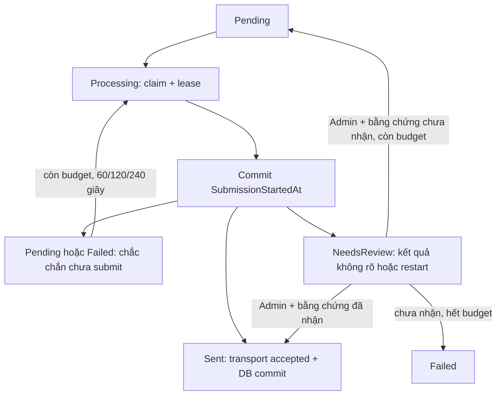

# #91 — SMTP không tự gửi lại khi kết quả chưa rõ

Phụ trách: Phan Thị Bảo Trâm, 2312778. Phần tiếp theo của PR #110/#113; giữ SMTP hiện có, không cần secret hoặc provider mới. Chính sách này cần được nhóm trưởng review như các thay đổi hành vi khác trước khi merge.

## Hành vi

`Message-ID` ổn định giúp tra cứu delivery nhưng không làm SMTP deduplicate. SMTP có thể đã nhận thư trong khi client mất phản hồi cuối; đây là cửa sổ được mô tả trong [RFC 5321 §4.5.3.2.6](https://www.rfc-editor.org/rfc/rfc5321.html#section-4.5.3.2.6).

Job commit `SubmissionStartedAt` **trước** khi gọi transport. Chỉ lỗi đã được transport chứng minh xảy ra trước gửi dữ liệu thư (kết nối/xác thực SMTP) được retry tự động. Lỗi trong lúc gửi, cancellation trong submission, lỗi ghi Sent hoặc lease hết sau dấu mốc submission đều giữ intent và chuyển `NeedsReview`. Recovery/duplicate dispatch không tự gửi lại các email này. Không coi Hangfire Succeeded là bằng chứng email đã Sent; trạng thái nghiệp vụ ở outbox mới là nguồn đối chiếu.



Mỗi delivery vẫn có tối đa bốn attempt (lần đầu + ba retry). Đối soát không reset count. Nếu chưa thể xác minh kết quả thì để `NeedsReview`; không đánh dấu Sent cho đẹp số liệu và không chuyển Pending bằng SQL.

Đây là chính sách chặn **tự động gửi lại khi không rõ kết quả**, có bước đối soát thủ công. Không tuyên bố exactly-once email đầu cuối hoặc tự động recovery hoàn toàn trong cửa sổ này. Không có giao dịch phân tán chung giữa SMTP và PostgreSQL.

## API vận hành (Admin)

Các endpoint dùng policy `AdminOnly`: Guest 401, Author 403. Dùng access token Admin hợp lệ theo luồng đăng nhập hiện có; không commit token vào repository.

### Danh sách chờ đối soát

`GET /api/v1/admin/welcome-emails/reconciliation?page=1&pageSize=20`

Contract phân trang `data/meta`, tối đa 50 mục/lượt. DTO chỉ có ID, Message-ID, UserId, attempt count, timestamps và mã lỗi; không trả recipient, nội dung thư, SMTP config, lease token hoặc exception. Thứ tự UpdatedAt/Id để duyệt ổn định.

### Xác nhận kết quả

`POST /api/v1/admin/welcome-emails/{deliveryId}/reconcile`

```json
{"outcome":"Accepted","evidenceReference":"SMTP-RECEIPT-123"}
```

- `Accepted`: chỉ dùng khi đã đối chiếu đúng delivery/Message-ID với biên nhận hoặc log acceptance của transport. Chuyển Sent, không gọi SMTP lại.
- `NotAccepted`: chỉ dùng khi có bằng chứng transport chưa nhận **và worker/submission cũ đã dừng, không còn I/O có thể hoàn tất muộn**. Thiếu mail trong inbox hoặc chưa nhận phản hồi không phải bằng chứng chắc chắn. Chuyển Pending nếu còn budget, Failed nếu đã dùng hết bốn attempt.
- `evidenceReference`: mã biên nhận/hồ sơ sự cố, 1–100 ký tự chữ/số/dấu chấm/gạch ngang/gạch dưới; không nhập secret, URL query hoặc nội dung mail. Admin chịu trách nhiệm kiểm tra bằng chứng trước khi xác nhận. API lưu mã tham chiếu để audit; không tự xác minh dữ liệu ở provider.
- UserId người đối soát lấy từ principal, không nhận từ body. Audit append-only ghi delivery, outcome, actor, evidence, thời điểm và attempt count cùng transaction với trạng thái.
- Cùng `(deliveryId, evidenceReference, outcome)` gửi lại là no-op và trả cùng audit ID. Cùng reference nhưng outcome khác: 409. Không cho sửa delivery chưa NeedsReview hoặc còn lease sống: 409. Validation: RFC 7807/422; không tồn tại: 404; errors có correlation ID.
- API không gửi email trực tiếp. Sau NotAccepted đã kiểm chứng, dispatcher nhận lại Pending theo lịch và tiếp tục với budget còn lại.

Không được gọi endpoint chỉ để vượt qua test/đóng issue. Nếu chưa có bằng chứng, giữ nguyên NeedsReview và theo dõi sự cố theo business key `job-welcome-<deliveryId:N>`.

## Triển khai / rollback

1. Dừng API/Hangfire worker của phiên bản cũ và bảo đảm không còn submission SMTP đang chạy trước khi áp dụng migration.
2. Áp dụng migration `QuarantineUnknownWelcomeEmailOutcomes` bằng quy trình deployment của repository. Migration bổ sung checkpoint và audit table, đưa legacy Processing hoặc Pending có AttemptCount > 0 vào NeedsReview vì không thể biết chúng đã gửi hay chưa. Không xóa intent hoặc reset attempt.
3. Lease cũ được giữ để ngăn đối soát quá sớm; kiểm tra worker cũ đã dừng rồi chờ lease hết. Khởi động API/worker phiên bản mới, xem hàng chờ và xử lý từng business key.
4. Rollback cần dừng worker trước, xuất/lưu hồ sơ audit theo quy trình vận hành. Down migration chuyển NeedsReview sang Failed với mã RollbackReviewRequired (không Pending) để binary cũ không gửi lại; schema checkpoint/audit bị gỡ khi downgrade. Khi nâng cấp lại, các record mang mã này quay về NeedsReview, không reset attempt. Không coi rollback là cách resume gửi; audit đã xuất vẫn cần giữ để đối soát.

Audit không có FK cascade để thao tác retention không làm mất intent đang cần xử lý. Dọn audit sau thời hạn retention chỉ khi delivery gốc đã hết vòng đời/bị dọn; giữ audit khi delivery còn Pending/Processing/NeedsReview. Recipient của unresolved intent được giữ để có thể tiếp tục đối soát, như pending outbox hiện có.

## Failure matrix bổ sung

| Điểm lỗi | DB sau lỗi | SMTP / recovery |
| --- | --- | --- |
| Queue lỗi trước claim | Pending, chưa có checkpoint | Không send; dispatcher retry |
| DB lỗi khi ghi checkpoint | Không gọi transport; Pending nếu ghi lại failure được, nếu không thì giữ claim/checkpoint | Recovery thận trọng; không báo Sent |
| Kết nối/xác thực thất bại chắc chắn trước submission | Pending/Failed, checkpoint được clear có điều kiện lease | Retry 60/120/240; cùng business key; không vượt bốn attempt |
| Timeout/cancellation/lỗi trong Send | NeedsReview; không Sent | Không tự resend, giữ original intent |
| SMTP accepted; cả ghi Sent và ghi NeedsReview lỗi DB | Processing + checkpoint đã commit | Sau restart/lease expiry chuyển NeedsReview, không send lần hai |
| Crash sau checkpoint | Processing + checkpoint | Recovery NeedsReview dù chưa biết chắc đã gửi; cần bằng chứng |
| Audit insert/DB commit lỗi lúc đối soát | Rollback cả decision và audit | Retry cùng reference; không tự gọi SMTP |
| Lặp/chạy đồng thời request đối soát | Một audit record; trạng thái nguyên tử | Không reset count hoặc gây resend trùng |
| Quá retention | Không dọn intent chưa giải quyết | Chỉ dọn terminal và audit không còn delivery theo chính sách |

## Kiểm tra

```powershell
.\Culinary_Blog_Nhom5\tests\run-integration.ps1 -Suites WelcomeEmail -ProjectPrefix culinary-issue91
.\Culinary_Blog_Nhom5\tests\run-integration.ps1 -ProjectPrefix culinary-issue91
```

Fixture PostgreSQL/MinIO/MailHog thật, Hangfire PostgreSQL thật, database/bucket riêng và cleanup theo runner thống nhất. Test cố ý gây lỗi finalize/audit, restart host, duplicate dispatch và request đồng thời. Ca MailHog kiểm tra đúng Message-ID/biên nhận trước khi gọi đối soát Accepted, xác nhận chỉ có một thư sau restart và duplicate job. API tests kiểm tra Guest/Author bị chặn, Admin được phép và 404/409/422 không làm thay đổi intent.

## Kết quả nghiệm thu 05/11/2026

**185 test đạt**: RecipeCreation 12, RecipeUpdate 21, RecipeDeletion 14, RecipeImages 7, ImageProcessing 35, WelcomeEmail 36, Ingredients 21, Steps 39.

Đợt chạy đủ tám suite có bảy suite đạt ngay; một assertion so sánh timestamp trong test migration email khác phần tick nhỏ hơn microsecond của PostgreSQL. Đã chuẩn hóa timestamp đầu vào test về microsecond, chạy lại toàn bộ WelcomeEmail và đạt 36/36. Không sửa logic lease để né lỗi; không diễn giải run đầu exit code 1 là run đã đạt. Kết quả cuối tổng hợp từng suite có provenance project trong JSON.

- [Tổng hợp từng suite và provenance](evidence/issue91/smtp-reconciliation-summary-20261105.json).
- [Failure/recovery và correlation evidence](evidence/issue91/smtp-reconciliation-recovery-20261105.json).

Mọi Compose project/container/network của các lần chạy đã được cleanup. EF `has-pending-model-changes` đạt; migrations chỉ áp dụng trên database test cô lập, chưa áp dụng vào database development/production. Không đổi frontend nên không chạy lại frontend build/lint trong phần bổ sung này.

Solution build cuối đạt **0 warning / 0 error**. Sau khi bổ sung xử lý re-upgrade cho record RollbackReviewRequired, [test migration downgrade/upgrade](evidence/issue91/smtp-review-migration-roundtrip-20261105.json) cũng đạt; đây là mở rộng một ca hiện có, không cộng trùng vào 185 test.
